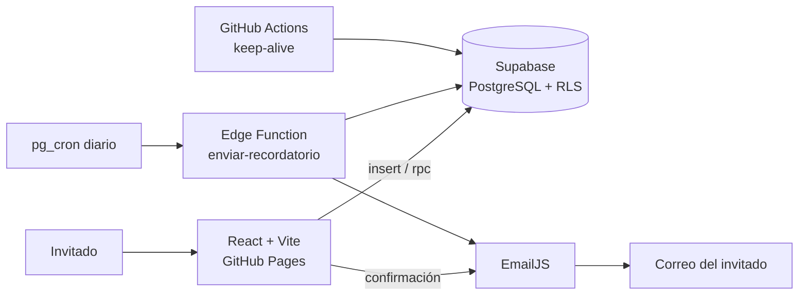
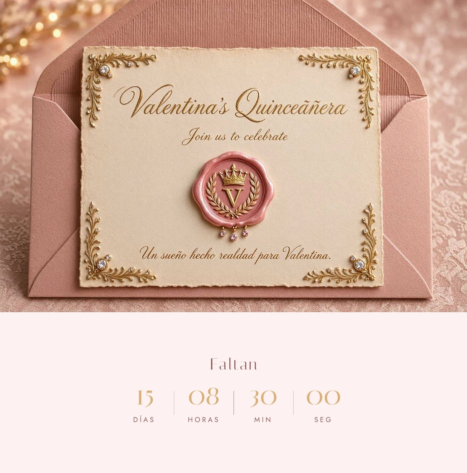
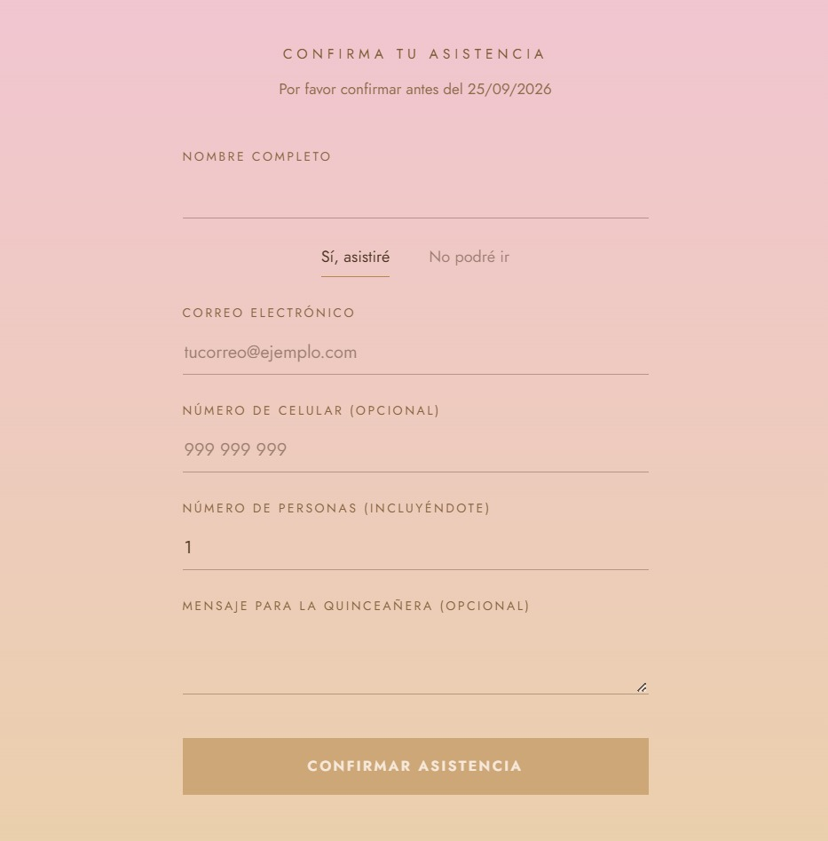
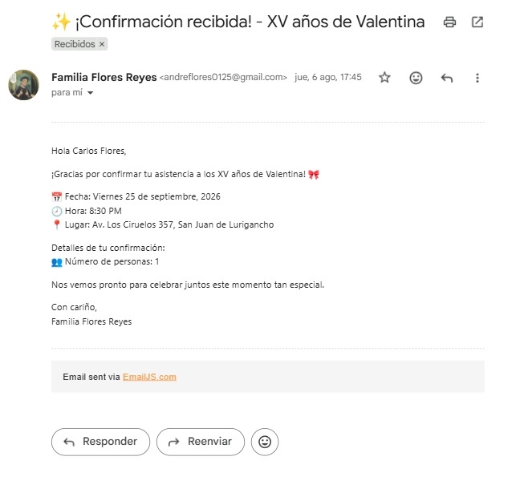

# 👑 Invitación Digital XV Años

Invitación web interactiva para unos XV años, con **confirmación de asistencia, control de cupos y correos automáticos**. Usada en un evento real con **151 invitados confirmados**.

🔗 **Demo en vivo:** https://andre1609.github.io/quince-valentina/
> Nota: el evento ya se realizó, por lo que el formulario está cerrado en la versión pública.


## ✨ Funcionalidades

- Sobre animado con música de fondo y pantalla de apertura
- Cuenta regresiva en tiempo real al evento
- Secciones de mensaje, agradecimientos, regalos y detalles (ubicación con Google Maps, código de vestimenta)
- **Formulario RSVP** con validación y registro en base de datos
- **Límite de 160 cupos**: al llegar al tope, el formulario se cierra automáticamente
- **Correo de confirmación** inmediato al registrarse
- **Recordatorio automático** el día del evento
- Diseño responsive (móvil y escritorio)

## 🛠️ Stack


**Servicios:** EmailJS (correos), Supabase Edge Functions + pg_cron (tareas programadas).

## 🏗️ Arquitectura



## 🔐 Decisiones técnicas y retos resueltos

| Reto | Solución |
|---|---|
| Filtrar duplicados sin exponer datos | Pasé la validación del navegador a una restricción `UNIQUE` en el email, y el error `23505` se muestra como mensaje amigable |
| Fuga de datos de invitados | Eliminé la lectura pública de la tabla con **RLS**; solo se permite `INSERT` al rol `anon` |
| Mostrar el cupo sin leer la tabla | Función SQL `get_total_confirmados()` con `SECURITY DEFINER` que devuelve solo un número |
| Correos en spam (DMARC) | Mailjet con remitente Gmail caía en spam; migré el envío a EmailJS, que usa los servidores de Gmail |
| Recordatorio sin intervención manual | Edge Function con validación de fecha, programada con `pg_cron` y marcada con `recordatorio_enviado` para evitar duplicados |
| Pausa por inactividad del plan gratuito | Workflow de GitHub Actions que consulta la base cada 3 días |

## 📸 Capturas

| Sobre | Cuenta regresiva | Formulario | Correo |
|---|---|---|---|
|  |  |  |  |

## 📊 Resultados

- **151** invitados confirmados de **160** cupos
- **2** correos automáticos (confirmación y recordatorio)
- **0** costo de infraestructura (planes gratuitos)

## 🚀 Ejecutar en local

```bash
npm install
npm run dev
```

Crea un `.env` con tus propias credenciales de Supabase y EmailJS. Para ver el contador antes del evento: `?fecha=2026-09-10T12:00:00`.

## 📝 Aprendizajes

Seguridad con RLS, diseño de funciones en Postgres, tareas programadas, integración de servicios de correo y despliegue continuo.
